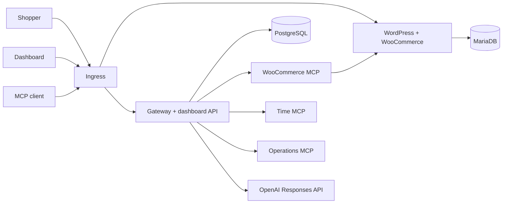

# StoreLink

StoreLink runs a WooCommerce store on Kubernetes and puts a team MCP gateway in front of it. An administrator registers MCP servers once in a React dashboard. Every team member can then use the tools of all enabled servers through a single authenticated MCP endpoint, or through a chat agent in the dashboard.

## Features

- **WooCommerce store:** WordPress, WooCommerce and MariaDB in the cluster, with persistent storage and cash-on-delivery checkout.
- **WooCommerce MCP server:** list products, create product, list orders, get order and update order status, served over Streamable HTTP. Reachable only from the gateway.
- **MCP gateway:** aggregates the tools of every enabled upstream behind one endpoint, namespaces tool names per server, and routes each call to its server. Every upstream call has a timeout.
- **Dashboard:** server registration with live status (Connected, Unreachable, Disabled) and the tools each server exposes. Also covers member invitations, API keys, and an audit log of every tool call.
- **Chat agent:** an OpenAI Responses tool loop that calls tools through the gateway as the signed-in user and shows each tool call it makes.
- **Access control:** admin and member roles, per-user API keys stored as HMAC digests, immediate revocation, and upstream credentials held server-side.
- **Deployment:** one Helm chart with separate values for local k3d and single-node k3s.

## Architecture



| Component                  | Responsibility                                                                       |
| -------------------------- | ------------------------------------------------------------------------------------ |
| `apps/dashboard`           | React dashboard: connections, access, activity and chat                              |
| `services/gateway`         | Express backend, aggregated MCP endpoint, upstream registry, audit log and chat loop |
| `services/woocommerce-mcp` | MCP server for store products and orders, using the WooCommerce REST API             |
| `services/time-mcp`        | Store timezone and day-window tools                                                  |
| `services/operations-mcp`  | Sales target and fulfillment policy tools                                            |
| `packages/shared`          | API key hashing, secret loading and MCP HTTP handling                                |
| `charts/storelink`         | Helm chart with `values-local.yaml` and `values-prod.yaml`                           |

Tools are exposed as `<server>__<tool>`, for example `woo__list_orders` and `time__get_day_window`. The time and operations servers both provide `get_status`, which appears as `time__get_status` and `ops__get_status`. The [system design](docs/system-design.md) describes routing, failure handling and the store integration, and the [threat model](docs/threat-model.md) covers credentials, upstream trust and member isolation.

## Requirements

- Linux with Docker Engine
- Node.js 24
- kubectl, Helm and k3d
- Git, curl and Python 3
- At least 4 GiB of memory for the k3d node
- An OpenAI API key, for the chat agent

`scripts/install-dev-tools.sh` installs Node, kubectl, Helm and k3d into `.tools/bin` if they are missing.

## Local setup

```sh
scripts/install-dependencies.sh
scripts/local-up.sh
export KUBECONFIG="$PWD/.data/kubeconfig"
kubectl -n storelink get pods
```

`local-up.sh` creates the k3d cluster, generates credentials into Kubernetes Secrets, builds and imports the images, and installs the chart. Run it again to deploy changes; data, passwords and key revocations persist across runs. The generated credentials are also saved to `.data/cluster-secrets.json`. Keep that file private.

| Service         | URL                                          |
| --------------- | -------------------------------------------- |
| Storefront      | <http://store.storelink.localhost>           |
| WordPress admin | <http://store.storelink.localhost/wp-admin/> |
| Dashboard       | <http://dashboard.storelink.localhost>       |
| MCP endpoint    | <http://dashboard.storelink.localhost/mcp>   |

Most systems resolve `*.localhost` to `127.0.0.1`, and k3d listens on ports 80 and 443 there. If your resolver doesn't, add both hostnames to `/etc/hosts`.

To show the generated passwords:

```sh
node scripts/local-credentials.ts --show
```

| Account          | Login                    |
| ---------------- | ------------------------ |
| Dashboard admin  | `admin@storelink.local`  |
| Dashboard member | `member@storelink.local` |
| WordPress admin  | `admin`                  |

## Usage

### Place an order

1. Open the storefront and add a product to the cart.
2. Go to checkout and enter a test address, for example Bengaluru, Karnataka, `560001`.
3. Choose **Cash on delivery** and place the order.
4. Find the order in WordPress admin under **WooCommerce → Orders**.

### Connect an MCP client

In the dashboard, open **Access** and generate an API key. It is shown only once. Then add the gateway to any MCP client that supports Streamable HTTP:

```json
{
  "mcpServers": {
    "storelink": {
      "type": "http",
      "url": "http://dashboard.storelink.localhost/mcp",
      "headers": { "Authorization": "Bearer <your API key>" }
    }
  }
}
```

With Claude Code:

```sh
claude -p --mcp-config member-mcp.json --strict-mcp-config --allowedTools mcp__storelink \
  "What orders came in today in the store's timezone? Then compare today's sales with the operations sales target."
```

With MCP Inspector, run `npx @modelcontextprotocol/inspector`, choose Streamable HTTP, and enter the same URL and header.

The client sees nine tools across `woo__`, `time__` and `ops__`. When an administrator changes a server, the gateway sends a tool-list change notification to the team's connected sessions. Calls to disabled tools, and calls made with revoked keys, are rejected. Idle sessions expire after 15 minutes.

`scripts/external-chat.ts` is a small terminal agent built on the same chat loop, useful for scripted checks:

```sh
STORELINK_GATEWAY_KEY_FILE=.data/member-key node --env-file=.env scripts/external-chat.ts "List today's store orders."
```

### Dashboard chat

Add your OpenAI key to `.env` and redeploy:

```dotenv
OPENAI_API_KEY=your-key
```

```sh
scripts/local-up.sh
```

The key is stored in a Kubernetes Secret and used only by the gateway. Example prompts:

- "Create a product named Team Mug priced at 149.00."
- "What orders came in today?"
- "Compare today's order total with our operations sales target."

Each answer lists the tools it called, and **Activity** shows the matching audit records. Conversations and token usage are saved per user.

### Administration

- **Connections:** add, edit, disable or remove MCP servers, each with an optional static header or bearer credential. The gateway pings each server every second, so a stopped or restarting server shows as Unreachable within about a second, and every status change is kept in the connection history. Public HTTPS servers on port 443 can be added directly. A cluster-internal server needs its origin in `gateway.extraUpstreamOrigins` and a matching `networkPolicies.gatewayEgress` rule. Credentials are encrypted with AES-256-GCM, stored in a Kubernetes Secret, and never returned by the API.
- **Access:** invite members, and issue or revoke API keys.
- **Activity:** the audit log of every tool call, showing user, server, tool, time, duration and outcome.

### Metrics

Administrators see each server's calls, error rate and average and p95 latency for the last 24 hours on its **Connections** card. The same summary is available as JSON from `GET /api/metrics?hours=<1-168>`.

The gateway serves Prometheus metrics on port `9464` at `/metrics`. The Ingress does not route it, and the default-deny NetworkPolicy closes it to other pods, so a Prometheus server must be allowed through `networkPolicies.metricsFrom`, for example `[{namespaceSelector: {matchLabels: {kubernetes.io/metadata.name: monitoring}}}]`. The pod carries `prometheus.io/scrape` annotations. To inspect it locally:

```sh
kubectl -n storelink port-forward svc/storelink-gateway 9464:9464
curl -s localhost:9464/metrics
```

| Metric                                              | Type      | Labels                              |
| --------------------------------------------------- | --------- | ----------------------------------- |
| `storelink_tool_calls_total`                        | counter   | `team`, `server`, `slug`, `outcome` |
| `storelink_tool_call_duration_seconds`              | histogram | `team`, `server`, `slug`            |
| `storelink_upstream_up`                             | gauge     | `team`, `server`, `slug`            |
| `storelink_upstream_status`                         | gauge     | `team`, `server`, `slug`, `status`  |
| `storelink_upstream_last_failure_timestamp_seconds` | gauge     | `team`, `server`, `slug`            |

For example, the error rate per server over five minutes is `sum by (server) (rate(storelink_tool_calls_total{outcome=~"failed|timeout|uncertain"}[5m])) / sum by (server) (rate(storelink_tool_calls_total{outcome!="denied"}[5m]))`.

## Configuration

Common chart values:

| Value                                                                      | Default                                                      | Description                                                                                           |
| -------------------------------------------------------------------------- | ------------------------------------------------------------ | ----------------------------------------------------------------------------------------------------- |
| `chat.enabled`                                                             | `false` (set by `local-up.sh`)                               | Enables the chat agent                                                                                |
| `chat.model`                                                               | `gpt-6-luna`                                                 | OpenAI model used by the chat agent                                                                   |
| `chat.limits.perUserHour`                                                  | `15`                                                         | Chat turns per user per hour                                                                          |
| `chat.limits.perUserConcurrent` / `perTeamConcurrent` / `globalConcurrent` | `1` / `4` / `16`                                             | Concurrent chat turns                                                                                 |
| `gateway.extraUpstreamOrigins`                                             | `[]`                                                         | Cluster-internal origins allowed as upstreams; each also needs a `networkPolicies.gatewayEgress` rule |
| `gateway.healthIntervalMs`                                                 | `1000`                                                       | Interval between upstream health probes                                                               |
| `gateway.metrics.enabled`, `gateway.metrics.port`                          | `true`, `9464`                                               | Prometheus metrics listener inside the cluster                                                        |
| `networkPolicies.enabled`                                                  | `true`                                                       | Default-deny NetworkPolicies with per-component rules                                                 |
| `networkPolicies.kubernetesApi.cidrs`, `.ports`                            | `[0.0.0.0/0]`, `[6443]`                                      | Where the gateway reaches the Kubernetes API                                                          |
| `networkPolicies.publicHttps`                                              | `true`                                                       | Gateway egress to public HTTPS (OpenAI, public servers)                                               |
| `networkPolicies.metricsFrom`                                              | `[]`                                                         | Peers allowed to scrape the metrics port                                                              |
| `networkPolicies.gatewayEgress`, `.wordpressEgress`                        | `[]`                                                         | Extra egress rules for the gateway or WordPress                                                       |
| `store.host`, `gateway.host`                                               | `store.storelink.localhost`, `dashboard.storelink.localhost` | Public hostnames                                                                                      |
| `store.timezone`                                                           | `Asia/Kolkata`                                               | Store timezone, which defines "today"                                                                 |
| `storage.className`                                                        | `local-path`                                                 | Storage class for the persistent volumes                                                              |
| `ingress.tls.enabled`                                                      | `false`                                                      | Serves both hosts over TLS from `ingress.tls.secretName`                                              |

Each chat turn is limited to 8 model rounds, 20 tool calls and 120 seconds.

## Production deployment (k3s)

The same chart deploys to a single-node k3s server. The differences are in `values-prod.yaml` and the Secrets you supply.

1. Install k3s with Traefik and NetworkPolicy enforcement ([quick start](https://docs.k3s.io/quick-start)). Open ports 80 and 443, and restrict SSH and Kubernetes API access. Set `networkPolicies.kubernetesApi.cidrs` to the server's address (`kubectl get endpoints kubernetes`).
2. Build both images and push them to a registry the server can pull from:

   ```sh
   docker build -f images/app/Dockerfile -t <registry>/storelink/app:<tag> .
   docker build -f images/store/Dockerfile \
     --build-arg WOOCOMMERCE_SHA256=5317434cb381b5fdc7c1dd6ee258324f08c390976aaf8d1199f2a0e9a3ab8586 \
     -t <registry>/storelink/wordpress:<tag> .
   ```

3. Copy `charts/storelink/values-prod.yaml` to a private file. Set the image references, hostnames and public URLs, the storage class and the volume sizes. Point DNS records for both hostnames at the server.
4. Generate credentials into the cluster:

   ```sh
   export KUBECONFIG=/path/to/production-kubeconfig
   STORELINK_STATE_DIR=.data/production node scripts/prepare-cluster-secrets.ts
   ```

   Provide `OPENAI_API_KEY` in the environment and set `chat.enabled: true` in your values file.

5. Create the TLS Secret and install the chart:

   ```sh
   kubectl -n storelink create secret tls storelink-tls --cert=fullchain.pem --key=privkey.pem
   helm upgrade --install storelink charts/storelink -n storelink -f production-values.yaml --wait --timeout 10m
   kubectl -n storelink wait --for=condition=complete jobs -l storelink/component=store-bootstrap --timeout=120s
   ```

6. Schedule backups of PostgreSQL, MariaDB, WordPress uploads and Secrets, and enable Secret encryption at rest.

The chart denies all pod traffic by default and opens only the connections each component uses. WordPress has no internet access, so plugin updates and WP-Cron requests to the public store URL fail; open them with `networkPolicies.wordpressEgress` if you need them.

## Upgrades and rollback

Every `helm upgrade` creates a new release revision. Store, MCP server and gateway changes all ship the same way: new image tags or values in one upgrade. Locally, `scripts/local-up.sh` builds new images and runs the upgrade.

### 1. Back up the data

Helm versions the Kubernetes manifests, not the data on the persistent volumes. Back up both databases, the WordPress uploads and the Secrets before each upgrade. Upstream credentials are encrypted with a key derived from the API key pepper, so `storelink-credentials` and `storelink-upstream-credentials` must be restored together:

```sh
backup=~/storelink-backups/$(date +%Y%m%d-%H%M%S) && mkdir -p "$backup"
kubectl -n storelink exec deploy/storelink-postgres -- \
  pg_dump -U storelink -d storelink --format=custom > "$backup/postgres.dump"
kubectl -n storelink exec deploy/storelink-mariadb -- \
  sh -c 'mariadb-dump -uroot -p"$MARIADB_ROOT_PASSWORD" --single-transaction --routines wordpress' > "$backup/mariadb.sql"
kubectl -n storelink exec deploy/storelink-wordpress -- \
  tar -C /var/www/html -czf - wp-content/uploads > "$backup/wordpress-uploads.tgz"
(umask 077; kubectl -n storelink get secret storelink-credentials storelink-upstream-credentials \
  -o yaml > "$backup/secrets.yaml")
```

### 2. Upgrade

```sh
helm history storelink -n storelink
helm upgrade storelink charts/storelink -n storelink -f production-values.yaml \
  --set-string images.app=<registry>/storelink/app:<new-tag> \
  --set-string images.store=<registry>/storelink/wordpress:<new-tag> \
  --wait --timeout 10m
kubectl -n storelink wait --for=condition=complete jobs -l storelink/component=store-bootstrap --timeout=180s
```

`--wait` returns once every workload passes its readiness probe. To change a single setting and keep everything else, use `--reuse-values --set <key>=<value>`. Each revision runs its own store bootstrap Job (`storelink-store-bootstrap-<revision>`), and gateway pods apply database migrations when they start. Both steps are idempotent.

### 3. Roll back

```sh
helm history storelink -n storelink
helm rollback storelink <revision> -n storelink --wait --timeout 10m
kubectl -n storelink wait --for=condition=complete jobs -l storelink/component=store-bootstrap --timeout=180s
```

A rollback creates a new revision that reapplies the selected revision's manifests: images, configuration, and that revision's bootstrap Job. Images referenced by earlier revisions must still be available in the registry.

A rollback does not undo:

- **PostgreSQL migrations.** Files in `services/gateway/migrations/` only add tables and columns and are safe to re-run. Older gateway versions run against the newer schema, and the added columns remain after a rollback.
- **WordPress and WooCommerce database changes.** Plugin or core updates can change the MariaDB schema, and that data is not versioned by Helm.
- **Data on the persistent volumes.** Orders, products, users, keys and audit records written after the upgrade remain in `storelink-postgres`, `storelink-mariadb` and `storelink-wordpress`.
- **Encrypted upstream credentials.** Gateways from releases before credential encryption cannot read the encrypted entries, so rolling back past that change leaves every upstream Unreachable. Restore `secrets.yaml` from a backup taken before the upgrade (see below), or re-enter the credentials in the dashboard.

### 4. Restore data

If an upgrade damages data, roll back first, then restore the backups:

```sh
kubectl -n storelink exec -i deploy/storelink-postgres -- \
  pg_restore -U storelink -d storelink --clean --if-exists --no-owner < "$backup/postgres.dump"
kubectl -n storelink exec -i deploy/storelink-mariadb -- \
  sh -c 'mariadb -uroot -p"$MARIADB_ROOT_PASSWORD" wordpress' < "$backup/mariadb.sql"
kubectl -n storelink exec -i deploy/storelink-wordpress -- \
  tar -C /var/www/html -xzf - < "$backup/wordpress-uploads.tgz"
kubectl -n storelink replace --force -f "$backup/secrets.yaml"
kubectl -n storelink rollout restart deploy/storelink-gateway deploy/storelink-wordpress
```

`replace --force` recreates both Secrets from the backup; `kubectl apply` of the same file is rejected because the Secrets have changed since. The uploads restore brings back missing and changed files but leaves files added after the backup.

## Development

```sh
npm run typecheck
npm test
npm run build:dashboard
npm run format:check
helm lint charts/storelink -f charts/storelink/values-local.yaml
helm template storelink charts/storelink -f charts/storelink/values-prod.yaml
```

Cluster smoke tests run against the local deployment:

```sh
node scripts/smoke-cluster.ts       # store tools and storefront checkout
node scripts/smoke-dashboard.ts     # dashboard, invitations, keys and server management
node scripts/smoke-failures.ts      # upstream outage, recovery and persistence
node scripts/smoke-pod-delete.ts    # deleted upstream pod shows as Unreachable, then recovers
node --env-file=.env scripts/smoke-chat.ts  # live chat flow (uses the OpenAI API)
```

The smoke tests drive Google Chrome through Playwright. `npm run dev:dashboard` starts Vite with API requests proxied to the deployed gateway. Scripts that modify the cluster take a shared lock; wrap manual changes with `node scripts/with-cluster-lock.ts -- <command>`.

## Stand-out items

| Item                     | Status                                 |
| ------------------------ | -------------------------------------- |
| #1 VPS deployment        | Documented and templated, not deployed |
| #6 Security hardening    | Implemented                            |
| #7 Scaling               | Partial: rate and concurrency limits   |
| #8 Observability         | Implemented                            |
| #9 Upgrades and rollback | Documented and rehearsed               |
| #2–#5, multi-store bonus | Not attempted                          |

[Verification](docs/verification.md#stand-out-items-and-additional-features) lists what each item covers and where it is implemented, along with additional features such as catalog change notifications, per-user conversations with token accounting, and single-use invitations.

## Documentation

- [System design and tradeoffs](docs/system-design.md)
- [Threat model](docs/threat-model.md)
- [Verification](docs/verification.md)
- [Development environment](docs/development-environment.md)
