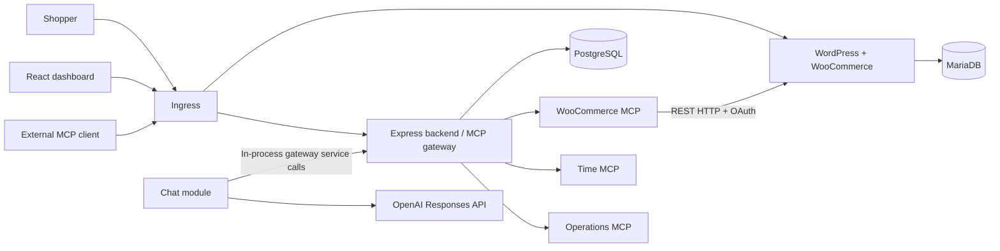

# System Design and Tradeoffs

## Architecture

The repository uses TypeScript, Node 24 and npm workspaces for the gateway backend, custom MCP servers and React/Vite dashboard. The gateway process serves the compiled dashboard SPA, the `/api/*` browser endpoints and the `/mcp` Streamable HTTP endpoint. Application state lives in PostgreSQL (`pg` + SQL migrations), while WordPress and WooCommerce use a separate MariaDB instance and persistent volume.

The gateway runs as a single replica, keeping MCP session state, routing tables and rate-limit counters in memory without a distributed cache.

## Store integration

`services/woocommerce-mcp` talks to the store through the WooCommerce `wc/v3` REST API so product creation and order updates go through WooCommerce's own validation, hooks and totals calculation. During cluster bootstrap, WP-CLI and `images/store/configure.php` install WordPress and WooCommerce, configure the store timezone and Cash on Delivery, seed a demo product, and provision the WooCommerce REST API key.

In both local and production deployments, the adapter calls WordPress over cluster-internal HTTP signed with OAuth 1.0a HMAC-SHA256 (`services/woocommerce-mcp/src/store-client.ts`):

- WooCommerce verifies OAuth signatures against the store's canonical `home`/`siteurl` origin (`store.storelink.localhost` locally or the public domain in production).
- `privateStoreSender` signs the request URL with the canonical hostname over HTTP and resolves the socket connection directly to the internal `storelink-wordpress` Service, preserving the `Host` header without hair-pinning through public DNS or Ingress.
- Redirects are rejected and the consumer secret is never placed in URLs.
- Order queries pass `dates_are_gmt=true`. `services/time-mcp` computes store-local day boundaries (including DST transitions) and returns exclusive second-precision UTC `after`/`before` bounds for `woo__list_orders`.

## Tool aggregation, routing and failure handling

The gateway (`services/gateway/src/gateway.ts`) uses `@modelcontextprotocol/sdk` as an MCP client to each upstream and as a Streamable HTTP server for downstream clients:

- **Namespacing and collision handling:** Public tool names follow `<slug>__<alias>` (capped at 64 characters). Each upstream has a unique slug per team (up to 16 characters), and tool names with special characters or length over 46 characters receive a deterministic `<prefix>_<sha256-8>` alias. The gateway stores the `<teamId>:<slug>__<alias>` route map in memory and dispatches calls by looking up the target upstream and original tool name. Colliding upstream tool names such as `get_status` on both `time` and `ops` are exposed as `time__get_status` and `ops__get_status`.
- **Timeouts and bounds:** Upstream TCP connections have a 2-second timeout (`undici.Agent`), tool discovery has a 3-second deadline (up to 5 pages / 200 tools), and tool calls have a 15-second deadline (256 KiB response cap). Arguments are validated against the upstream's JSON Schema with Ajv before dispatch.
- **Health probing and failure isolation:** The gateway pings each connected upstream every second (`gateway.healthIntervalMs`, 1-second deadline) and refreshes full tool catalogs every 15 seconds. If a health probe, discovery or tool call fails with a transport or timeout error, only that upstream is marked `Unreachable`, its routes are removed from the active catalog, and the `Unreachable` state is held for a 2-second retry window before rediscovery. Upstream MCP client transports reset on probe or discovery failure so a restarted pod receives a fresh session. Status transitions and timestamps are persisted to PostgreSQL (`upstream_events` and `upstream_servers`).
- **Metrics:** Call metrics are derived from `audit_calls`, which already records every call's server, outcome and duration (`services/gateway/src/metrics.ts`). One aggregation query, shared by PostgreSQL and the SQLite test store, counts outcomes and fills a fixed latency histogram (5 ms to 15 s buckets). The gateway serves the result in Prometheus format on a separate port (`gateway.metrics.port`, default `9464`) that the Ingress does not route and the NetworkPolicy opens only to peers listed in `networkPolicies.metricsFrom`, so tool names and call volumes are not public. Administrators also see a 24-hour summary per server (calls, error rate, average and p95 latency, with p95 interpolated from the histogram buckets) in the dashboard and at `GET /api/metrics`. Members do not receive team-wide metrics, matching the audit log's visibility.
- **Downstream sessions and catalog notifications:** `/mcp` uses stateful Streamable HTTP sessions (`services/gateway/src/mcp.ts`) with JSON POST responses and a GET SSE stream. When a team's tool catalog changes (server added, edited, disabled, removed, failed or recovered), the gateway sends `notifications/tools/list_changed` only to active sessions belonging to that team. Every request rechecks user and API key status; sessions expire after 15 minutes idle (capped at 8 per user / 256 globally).
- **Mutations and auditing:** Write tools (`create_product`, `update_order_status`) are annotated with `readOnlyHint: false` and are never automatically retried. If a connection drops or times out after a write request is sent, the adapter and gateway return and audit the outcome as `uncertain` so callers check state before retrying. Every tool call writes a `started` audit record to PostgreSQL before dispatch and updates it with the duration and outcome (`success`, `failed`, `timeout`, `uncertain`, or `denied`). If the audit write fails, the tool call is aborted.

## Access control, credentials and chat

- **Sessions and API keys:** User passwords use Argon2id. Browser sessions use `HttpOnly`, `SameSite=Strict` cookies (8-hour TTL) backed by server-side HMAC digests and paired with a CSRF header token. Per-user API keys are 32 random bytes prefixed with `storelink_` and stored in PostgreSQL as indexed `HMAC-SHA256(pepper, key)` digests using a Secret-held pepper. Revoked key rows are retained so post-revocation calls are rejected with HTTP 401 and attributed to the key owner in the audit log.
- **Upstream credentials and SSRF checks:** Upstream credentials are stored in a dedicated Kubernetes Secret (`storelink-upstream-credentials`) as AES-256-GCM envelopes keyed from the API key pepper, with the credential ID as authenticated data; PostgreSQL stores only the key reference. On startup the gateway encrypts any plaintext entries left by older releases. A namespaced `Role` (`charts/storelink/templates/registry-rbac.yaml`) restricts the gateway `ServiceAccount` to `get` and `patch` on that single Secret. Admins can register public HTTPS upstreams directly in the dashboard; `UpstreamPolicy` resolves DNS and verifies that all returned IP addresses are public unicast addresses both at registration time and in the socket `lookup` callback. Cluster-internal HTTP upstreams require an explicit entry in `gateway.extraUpstreamOrigins` and a `networkPolicies.gatewayEgress` rule, since the gateway's egress policy otherwise allows only its own MCP servers, PostgreSQL, the Kubernetes API and public HTTPS on port 443.
- **Chat loop:** `services/gateway/src/chat.ts` runs an OpenAI Responses API tool loop (`gpt-6-luna` default; bounded to 8 rounds, 20 tool calls and 120 seconds per turn). On each round it fetches `gateway.listTools(actor)` and executes model tool calls through `gateway.call(actor, ...)`, sharing the exact authorization and audit path used by external MCP clients. Conversations and token counts are persisted per user.

## Production changes

Local (`values-local.yaml`) and production (`values-prod.yaml`) deployments use the same Helm chart (`charts/storelink`):

- **DNS and Ingress:** Local setup uses `store.storelink.localhost` and `dashboard.storelink.localhost` over HTTP on k3d's loopback load balancer. Production sets public hostnames (`store.host`, `gateway.host`), `https://` public URLs, and `ingress.tls.enabled: true` with TLS Secret `storelink-tls`.
- **Images:** Local setup builds and imports `storelink-app` and `storelink-wordpress` into k3d; production pulls tagged images from a container registry.
- **Storage class and volumes:** Both profiles default to `local-path` PVCs (`wordpress`, `mariadb`, `postgres`), with larger volume sizes in `values-prod.yaml` (10Gi / 5Gi / 5Gi). On a single-node k3s VPS, `local-path` stores data on the node disk and requires off-node backups.
- **Secrets:** `scripts/prepare-cluster-secrets.ts` generates independent database passwords, the WooCommerce REST key pair, MCP service tokens, the API key pepper, bootstrap credentials, and the OpenAI API key into `storelink-credentials` and `storelink-upstream-credentials`.

## Upgrades and rollback

Each Helm revision captures the workload manifests, image tags, configuration and a revision-stamped store bootstrap Job (`storelink-store-bootstrap-<revision>`). Every upgrade or rollback runs the idempotent WordPress/WooCommerce bootstrap script, and Helm prunes the previous revision's Job. Gateway pods apply SQL migrations from an init container on startup.

Application SQL migrations (`services/gateway/migrations/`) are additive and idempotent (`CREATE TABLE IF NOT EXISTS`, `ADD COLUMN IF NOT EXISTS` with nullable or defaulted columns), allowing an older gateway image to run against a newer schema after a `helm rollback`.

Helm revisions do not snapshot PVC contents. Rolling back restores container images and Kubernetes manifests while keeping existing orders, products, users, API keys, audit logs, and database schema changes. Back up PostgreSQL, MariaDB and `wp-content/uploads` before upgrading so data can be restored if needed; see the [README](../README.md#upgrades-and-rollback) for the exact commands.
