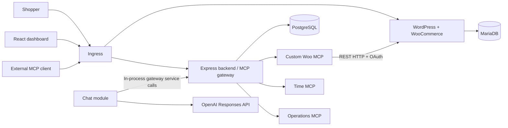

# System Design and Tradeoffs

## Architecture

TypeScript/Node 24 and npm workspaces keep the backend, custom MCP servers and React/Vite dashboard in one repository. The backend serves the built dashboard, browser API and MCP endpoint. SQL migrations and the `pg` driver implement application persistence; Drizzle is installed but is not the active query layer. WordPress uses a separate MariaDB and content PVC. Both databases and all application services run in Kubernetes.

One gateway replica keeps routing/configuration caches and throttles simple. This is a single-node submission design: failover, distributed rate limits and multi-replica synchronization need additional work.

## Store authentication

The custom adapter calls WooCommerce `wc/v3` REST rather than manipulating order/product tables. This preserves WooCommerce validation. WP-CLI and one PHP bootstrap script install/configure the store, seed a product and create the integration credential.

Both environments use OAuth 1.0a HMAC-SHA256 over direct internal HTTP. The adapter signs an HTTP URL with the canonical public hostname and privately resolves that hostname to the WordPress Service. It preserves the canonical Host without routing through public DNS/Ingress. Public HTTPS does not change this internal authentication path. Redirects are rejected, never followed. The consumer secret stays out of URLs. OAuth authenticates requests but does not encrypt the hop or sign JSON bodies; stronger internal transport needs TLS or a service mesh.

This transport has passed against the actual local WordPress 7.1.3 / WooCommerce 11.2.1 deployment. Fixture checks cover public HTTP and HTTPS settings; a real public HTTPS deployment remains unverified. Order queries set `dates_are_gmt=true`; the Temporal-based time server supplies store-local day boundaries, including DST, with the adapter’s exclusive second-precision filters.

## Aggregation, routing and failure handling

The gateway uses MCP SDK 1.28.0 as an upstream client and downstream Streamable HTTP server. Discovery runs independently per server, with a three-second deadline, at most five pages/200 tools, and bounded metadata. Calls have a fifteen-second deadline and bounded results.

Public tool names are `<slug>__<alias>` within 64 characters. Slugs are team-unique and at most sixteen characters; unusual tool names receive a deterministic normalized/hash alias. A stored runtime mapping routes each name to server ID and original tool name. Both time and operations expose `get_status` and route independently.

Disabling/removing a server immediately removes routes and fences older discoveries. Each call rechecks the actor and enabled route, then validates arguments. A failed connection removes only that server’s tools. Independent periodic refresh restores healthy catalogs. Status transitions and last success/failure timestamps are persisted for the dashboard; readiness depends on PostgreSQL, not on every upstream.

The downstream gateway uses SDK 1.28.0 Streamable HTTP sessions with JSON POST replies and a GET SSE stream for `notifications/tools/list_changed`. Catalog changes are coalesced per team, and unchanged discovery emits no notification. Every request reauthenticates; sessions are bound to user/team/key, with 15-minute idle expiry, 256 global sessions and eight per user. Revoked/disabled identities receive no further catalog notifications. DELETE releases a session. Sessions and notification delivery are in-memory on the single gateway replica; restart/expiry requires reconnecting, and missed events are recovered by a fresh tools/list. Upstream adapters remain stateless. Clients that ignore notifications can refresh manually. The implementation follows the transport supported by the pinned v1 SDK; see the [official SDK guide](https://ts.sdk.modelcontextprotocol.io/server).

Mutations are never automatically retried. Lost write responses, including adapter-to-store failures, are returned/audited as uncertain. A read/check is required before retrying. Audit attempts are persisted before dispatch; failure to start an audit prevents execution. A crash can leave a visible `started` record.

## Access, secrets and chat

Passwords use Argon2id. Browser sessions use random HttpOnly/SameSite cookies with eight-hour expiry, server-side HMAC lookup and CSRF checks. API keys contain 32 random bytes and use indexed `HMAC-SHA256(Secret-held pepper, full key)` digests. This provides direct lookup without scanning Argon2 hashes or trusting prefixes. Revoked records remain attributable. Pepper rotation requires explicit key/session reissuance.

Users, server registrations, calls and conversations are team-scoped; conversations and member keys are owner-scoped. Invitations are hashed, single-use and expire after 24 hours. The initial UI supports one team; membership currently lives on the user row.

Static upstream credentials live in one dedicated Kubernetes Secret, with registration metadata in PostgreSQL. The gateway ServiceAccount can only `get`/`patch` that named Secret. Browser routes never return values. Admins can register public HTTPS origins directly. DNS answers must all be public and are checked again at socket connection time, with those checked addresses passed directly to the connection. Private/internal origins require an exact operator-configured allowlist entry. Redirects, query strings and URL-embedded credentials are rejected. Runtime credential changes use the dashboard; externally editing the Secret requires a gateway restart to replace cached clients.

Chat translates the current gateway catalog to OpenAI Responses function tools. It retains response/reasoning items and matches each call ID. Execution uses the same in-process gateway service and verified session principal as external MCP calls. Client credentials never go to upstreams or OpenAI. Conversations/token counts persist in PostgreSQL. Limits: eight rounds, twenty calls, 120 seconds, bounded context/output and per-user throttling. See the [OpenAI function-calling guide](https://developers.openai.com/api/docs/guides/function-calling).

## Production changes

Use the same Helm chart with production image references, public DNS/HTTPS hosts, TLS Secret, fresh application/adapter/model Secrets, and appropriate storage class/PVC sizes. The chart supplies probes, resource bounds and gateway-only upstream NetworkPolicies. A single-node `local-path` installation requires off-node database/content/Secret backups and restore testing. Production also needs operational log retention, credential recovery/rotation procedures, ingress abuse controls and stronger internal transport if the node/network trust boundary is insufficient.

## Upgrades and rollback

Each Helm revision captures the full set of manifests: image tags, configuration and the store bootstrap Job. The Job is named per revision (`storelink-store-bootstrap-<revision>`), so every upgrade or rollback reruns the idempotent WordPress and WooCommerce setup, and Helm prunes the previous revision's Job. Gateway pods apply the application migrations from an init container on every start.

Rollback is safe for the application schema because migrations are additive and re-runnable (`CREATE TABLE IF NOT EXISTS`, `ADD COLUMN IF NOT EXISTS`), and every added column is nullable or has a default. An older gateway runs against a newer schema and ignores columns it does not know. Destructive schema changes need a separate expand-and-contract release: add the new structure, migrate readers and writers, then remove the old structure in a later upgrade.

Helm does not version persistent volume data. A rollback restores manifests and images but keeps orders, products, users, keys, audit records and any WooCommerce schema changes. Back up PostgreSQL, MariaDB and WordPress uploads before every upgrade, and restore them after rolling back if data must return to the earlier state. The README contains the backup, upgrade, rollback and restore commands.

See [README](../README.md) for deployment and [verification](verification.md) for tested behavior versus remaining acceptance work.
